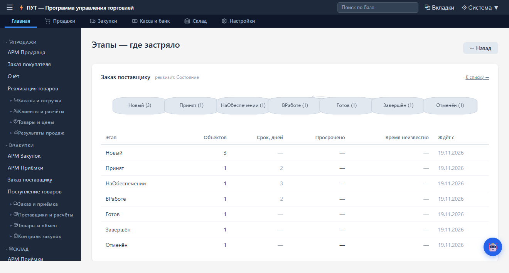
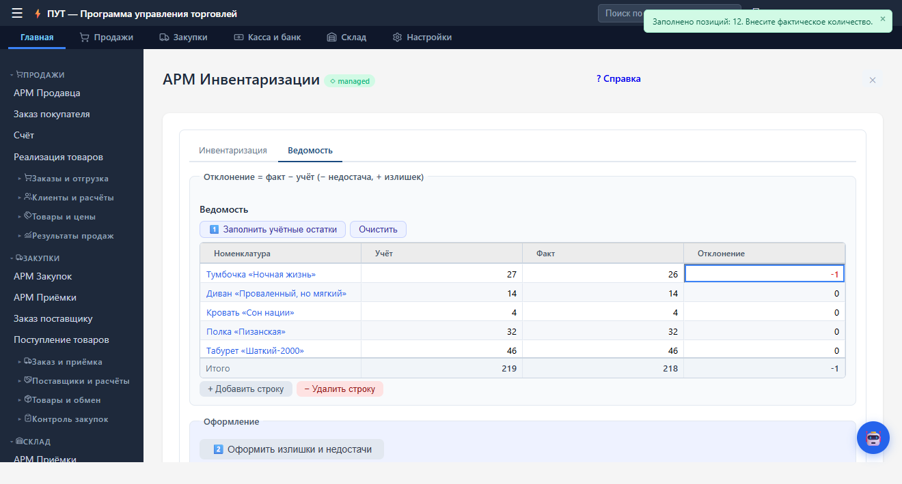
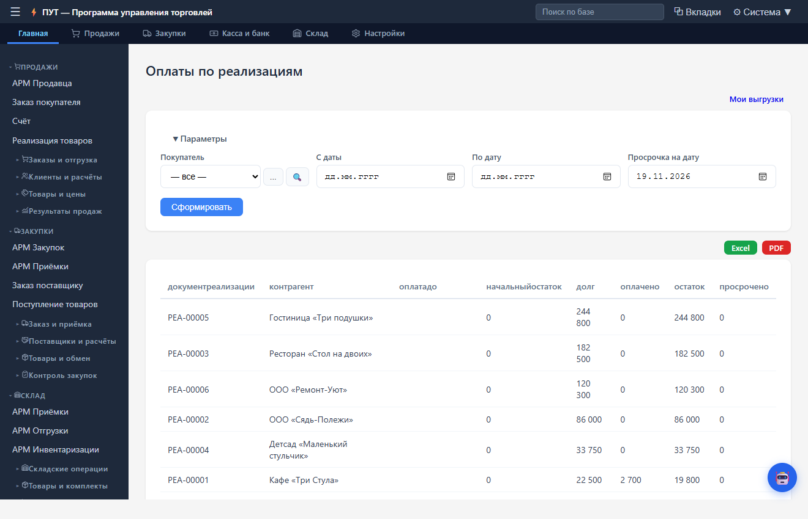

# ПУТ — управление торговлей на OneBase

ПУТ помогает оптовой или розничной компании вести заказ покупателя от резерва до оплаты. Менеджер видит, какой товар уже можно отгрузить, закупщик оформляет заказ поставщику, а после продажи бухгалтер может сверить долг и выгрузить документы в 1С.

[Открыть демо](https://demo.ivantitov.tech/login) · [Руководство пользователя](docs/help/introduction.md) · [Что изменилось в 1.3.4](docs/RELEASE_1.3.4.md)


## Что можно сделать в ПУТ

| Раздел | Задачи |
| --- | --- |
| Продажи | Зарезервировать товар под заказ, выставить счёт, провести отгрузку со скидкой и оформить возврат. В карточке покупателя видны долги и неоплаченные документы. |
| Закупки | Заказать товар у поставщика под потребность клиента, принять частичную поставку, проверить остаток в пути и закрыть непоставленное количество. |
| Склад | Посмотреть остатки и резервы, переместить товар, собрать комплект по спецификации и провести инвентаризацию. Себестоимость списывается по ФИФО. |
| Касса и банк | Принять оплату, оплатить поставку, загрузить выписку и подготовить выгрузку для бухгалтерии. Платёжный календарь показывает открытые долги по срокам оплаты. |
| Настройки | Завести организацию, задать типы цен и проверить результаты загрузки файлов в «Сверке обменов». |

**Ограничение версии 1.3.4.** Если организации используют общий склад, «План закупок» может занизить потребность на остаток другого юрлица. В этом сценарии создание заказа из расчёта также завершается ошибкой ссылки на товар. Откройте «Склад → Контроль запасов → Свободные остатки товаров», выберите организацию и склад, сверьте количество и оформите «Заказ поставщику» напрямую.

## Как это выглядит

**Заказы поставщикам.** По каждому этапу видны количество заказов, нормативный срок в днях и просрочка.



**Инвентаризация.** Кладовщик заполняет ведомость учётными остатками и вводит фактическое количество. По расхождениям можно оформить излишки и недостачи.



**Оплаты по реализациям.** По каждой продаже видны входящий долг, начисления, оплаты и остаток на конец периода. Платёж без документа-основания отражается в общем сальдо контрагента.



Снимки сделаны в браузере на демоданных ПУТ 1.3.4. Подробнее о работе с [заказами и резервами](docs/help/orders.md), [товарами на складе](docs/help/warehouse.md) и [взаиморасчётами](docs/help/money.md).

## Интеграции и отчёты

- **1С:Бухгалтерия предприятия 3.0.** ПУТ выгружает 17 видов документов в JSON. На стороне 1С файл загружается отдельной внешней обработкой `PuT-BP3_v1.epf`. Состав выгрузки, версии и порядок загрузки описаны в [руководстве по обмену с БП](docs/BP3_EXCHANGE.md).
- **Банк и поставщики.** Перед импортом банковской выписки можно проверить строки в предпросмотре. Для входящих УПД доступна загрузка XML. Результаты импорта и ошибки доступны в журнале обменов. [Работа с УПД](docs/help/operator.md)
- **Аналитика.** Есть отчёты по свободным остаткам, товарам в пути, исполнению заказов и валовой прибыли. Отчёт «ABC-анализ продаж» ранжирует товары по валовой прибыли. Состав объектов и отчётов приведён в [справочнике конфигурации](DOCS.md).

## Локальный запуск на Windows

Склонируйте репозиторий и откройте его каталог в PowerShell. Для версии **1.3.4** соберите OneBase **`0.13.0+put.5.ac6231b8`** по [инструкции сборки](platform-patches/README.md), затем запустите стенд из корня ПУТ.

```powershell
.\scripts\start_preview.ps1
```

При первом запуске скрипт создаст SQLite, заполнит её демоданными и откроет браузер. Логин администратора — `preview`, сгенерированный пароль хранится в `.local/credentials.txt`. [Адрес стенда и сценарии проверки](docs/LOCAL_PREVIEW.md)

## Материалы проекта

- [Платформа OneBase](https://github.com/ivanarama/onebase) и [справочник разработчика конфигурации](AGENTS.md)
- [Проверки в GitHub Actions](.github/workflows/ci.yml) и [порядок работы с issues и pull requests](MAINTENANCE.md)
- [Статья о проекте на Инфостарте](https://infostart.ru/1c/articles/2694204/)
