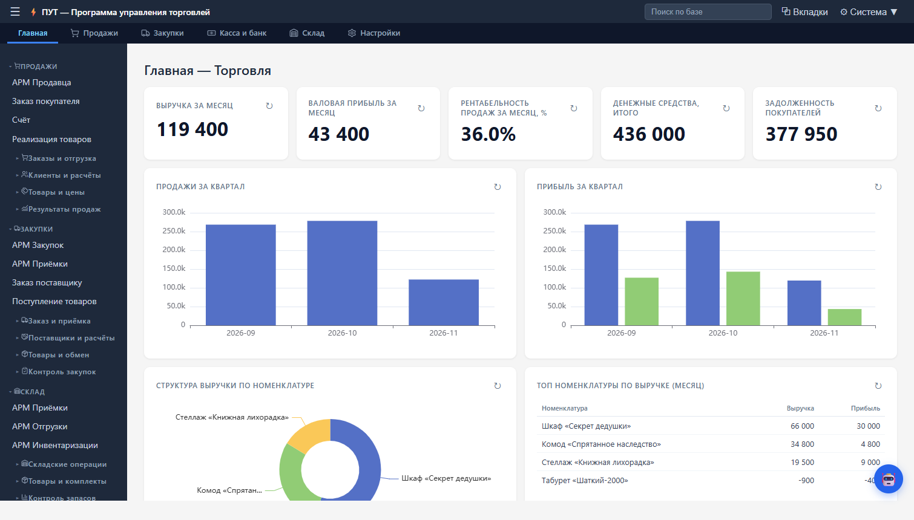

# ПУТ — управление торговлей на OneBase

ПУТ помогает оптовой или розничной компании вести заказ покупателя от резерва до оплаты. Менеджер видит, какой товар уже можно отгрузить, закупщик оформляет заказ поставщику, а после продажи бухгалтер может сверить долг и выгрузить документы в 1С.

[Открыть демо](https://demo.ivantitov.tech/login) · [Скачать для Windows](https://github.com/ivanarama/PuT/releases/latest) · [Руководство пользователя](docs/help/introduction.md) · [Что изменилось в 1.4.0](docs/RELEASE_1.4.0.md)



## Что можно сделать в ПУТ

| Раздел | Задачи |
| --- | --- |
| Продажи | Зарезервировать товар под заказ, выставить счёт, провести отгрузку со скидкой и оформить возврат. В карточке покупателя видны долги и неоплаченные документы. |
| Закупки | Заказать товар у поставщика под потребность клиента, указать подтверждённые даты по строкам, принять частичную поставку, проверить остаток в пути и закрыть непоставленное количество. |
| Склад | Посмотреть остатки и резервы, переместить товар, собрать комплект по спецификации и провести инвентаризацию. Себестоимость списывается по ФИФО. |
| Касса и банк | Разнести одну оплату по нескольким документам, учесть остаток авансом, загрузить выписку и подготовить выгрузку для бухгалтерии. Платёжный календарь показывает открытые долги по срокам оплаты. |
| Настройки | Завести организацию, задать типы цен и проверить результаты загрузки файлов в «Сверке обменов». |

## Как это выглядит

**Заказы поставщикам.** По каждому этапу видны количество заказов, нормативный срок в днях и просрочка.


**Инвентаризация.** Кладовщик заполняет ведомость учётными остатками и вводит фактическое количество. По расхождениям можно оформить излишки и недостачи.


**Распределение платежа.** В одном банковском документе укажите реализации и сумму по каждой. Отчёт «Оплаты по реализациям» покажет, какие долги погашены. Нераспределённая часть платежа учитывается как аванс.


Снимки сделаны в браузере на демоданных ПУТ. Подробнее о работе с [заказами и резервами](docs/help/orders.md), [товарами на складе](docs/help/warehouse.md) и [взаиморасчётами](docs/help/money.md).

## Интеграции и отчёты

- **1С:Бухгалтерия предприятия 3.0.** ПУТ выгружает 17 видов документов в JSON. На стороне 1С файл загружается отдельной внешней обработкой. Для платежей с распределением требуется приёмник формата 1.1. Состав выгрузки, версии и порядок загрузки описаны в [руководстве по обмену с БП](docs/BP3_EXCHANGE.md).
- **Банк и поставщики.** Перед импортом банковской выписки можно проверить строки в предпросмотре. Для входящих УПД доступна загрузка XML. Результаты импорта и ошибки доступны в журнале обменов. [Работа с УПД](docs/help/operator.md)
- **Аналитика.** Есть отчёты по свободным остаткам, товарам в пути, исполнению заказов и валовой прибыли. «ABC-анализ продаж» присваивает товарам классы A, B и C по вкладу в валовую прибыль. Границы классов можно задать перед формированием отчёта. Состав объектов и отчётов приведён в [справочнике конфигурации](DOCS.md).

## Локальный запуск на Windows

В [релизе](https://github.com/ivanarama/PuT/releases/latest) скачайте ZIP с пометкой `windows-amd64` и распакуйте его целиком. Архив содержит конфигурацию, проверенную сборку OneBase и инструкцию `START-HERE.txt`. Откройте извлечённый каталог в PowerShell и запустите стенд.

```powershell
.\scripts\start_preview.ps1
```

Скрипт создаст SQLite с демоданными и откроет браузер. Логин администратора — `preview`, сгенерированный пароль хранится в `.local/credentials.txt`. Для самостоятельной сборки из Git доступны [инструкция сборки платформы](platform-patches/README.md) и [сценарии проверки стенда](docs/LOCAL_PREVIEW.md).

## Материалы проекта

- [Платформа OneBase](https://github.com/ivanarama/onebase) и [справочник разработчика конфигурации](AGENTS.md)
- [Проверки в GitHub Actions](.github/workflows/ci.yml) и [порядок работы с issues и pull requests](MAINTENANCE.md)
- [Статья о проекте на Инфостарте](https://infostart.ru/1c/articles/2694204/)
