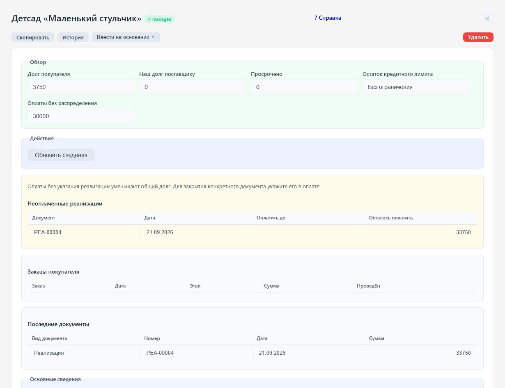
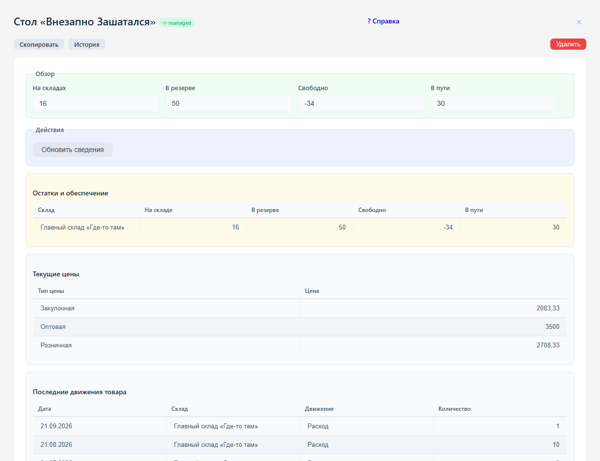

# Карточки клиента и товара

## Клиент

Откройте «Контрагенты» и выберите клиента. Сводка находится в начале карточки.

В карточке контрагента видны долг покупателя, наш долг поставщику, просроченная оплата, остаток кредитного лимита, неоплаченные реализации, заказы и история документов. Сводки читают реальные движения, включая оплаты и возвраты. «Обновить сведения» перечитывает данные без сохранения карточки.

В меню «Ввести на основании» выберите заказ покупателя или счёт. Откроется новый документ с заполненным клиентом; добавьте товары и сохраните его.

В карточке отдельно показана сумма оплат без привязки к реализации. Чтобы погасить несколько продаж одним платежом, добавьте реализации и суммы в таблицу «Распределение платежа». Остаток суммы попадёт в аванс. [Как распределить платёж](money.md#один-платёж-по-нескольким-документам)

## Товар

Откройте «Номенклатура» и выберите товар. Карточка показывает физический остаток, резерв, свободное количество и товары в пути по складам, цены на сегодня и последние движения. Сводные таблицы предназначены для просмотра.

Отрицательное свободное количество означает, что резерв превышает физический остаток. Проверьте ожидаемые поставки и обеспечение заказов. В таблице цен показываются и расчётные типы цен.

## Установка цен

Откройте «Установка цен», укажите дату действия и тип цены, заполните товары и цены в строках. Проверьте значения перед записью и проведением. После проведения откройте карточку товара и обновите сведения: в сводке показываются цены, действующие сегодня. Если дата установки ещё не наступила, проверяйте цены на нужную дату в отчёте «Цены номенклатуры».
