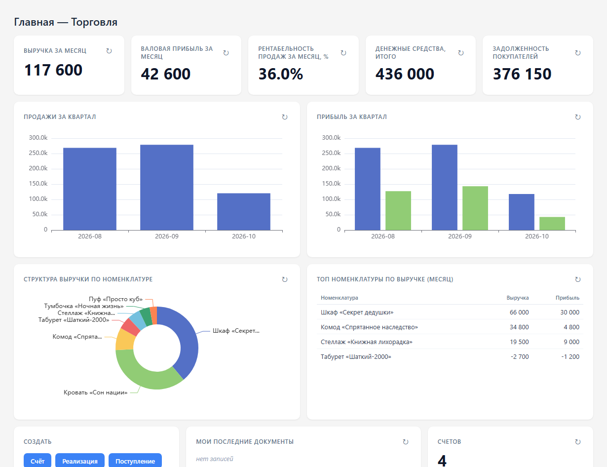
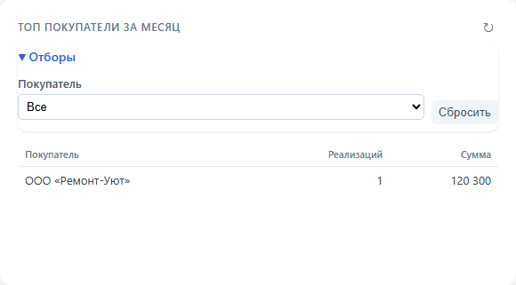
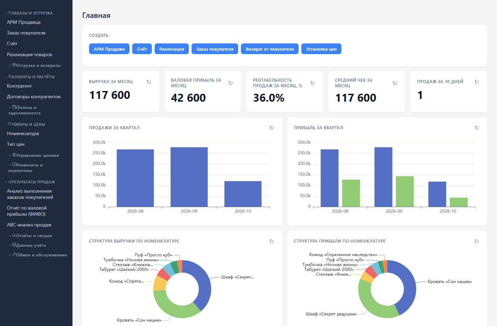

# ПУТ — торговля и склад

На главной показаны выручка, прибыль, задолженность и обеспечение заказов. Нажмите показатель, чтобы открыть отчёт; строку рейтинга — чтобы открыть карточку клиента или товара. Отборы таблиц раскрываются кнопкой «Отборы».

Раскройте «Отборы» нужного виджета, выберите клиента, склад или период. Отбор применяется к этой таблице и сохраняется при обновлении страницы. Число рядом с кнопкой показывает количество заполненных отборов.

В разделах меню показываются рабочие инструменты вашей роли. Права на чтение справочников для подбора сохраняются. После записи документов показатели обновляются автоматически.

Слева команды собраны по задачам: «Заказы и отгрузка», «Клиенты и расчёты», «Товары и цены», «Результаты продаж». В других разделах используются свои группы: «Заказ и приёмка», «Складские операции», «Касса и банк». Нажмите заголовок, чтобы свернуть или раскрыть группу; вложенные папки отчётов и обслуживания раскрываются отдельно.

Начните с [карточек клиента и товара](cards.md), затем переходите к [заказам](orders.md) и [ежедневным операциям](operator.md). Запуск и проверка [длительных операций](jobs.md) описаны отдельно.

Все иллюстрации сняты на демонстрационных данных. Названия, суммы и даты в вашей базе будут отличаться.
