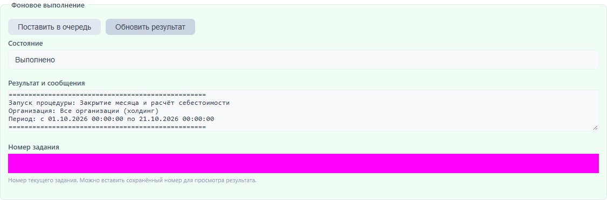

# Длительные операции

Закрытие месяца, импорт номенклатуры и выгрузку БП3 можно поставить в очередь. Укажите параметры и нажмите «Поставить в очередь». После запуска нажмите «Обновить результат»: состояние и сообщения появятся в форме. Дождитесь состояния «Выполнено» и проверьте итоговые сообщения. Если планируете закрыть вкладку раньше, сохраните номер задания: операция продолжит выполняться на сервере.

Проверьте итоговые сообщения, включая количество ошибок. Сохраните номер задания, если понадобится вернуться к результату: откройте обработку, вставьте номер и нажмите «Обновить результат». На иллюстрации номер скрыт.

Задания выполняются последовательно. Повторное нажатие, пока операция ожидает или выполняется, возвращает ту же задачу. Если параметры отличаются, форма сообщает, что ваш запрос не поставлен. Дождитесь завершения активного задания и повторите запуск. После завершения можно запустить новую операцию. Автоматических повторов после ошибки нет; проверьте сообщения и результаты перед повторным запуском.

При импорте JSON товар сопоставляется по артикулу, а при его отсутствии — по точному наименованию. Повторный импорт обновляет найденный товар. Используйте уникальные артикулы. Для выгрузки укажите путь на машине сервера. Закрытие месяца перепроводит документы в хронологическом порядке; при ошибках дата запрета не устанавливается.

Перед закрытием укажите дату окончания и нажмите «Сверить учёт на дату окончания». Обработка сверяет движения склада с партиями, товары в пути со строками заказов и поступлений, начисленный долг с документом и стороной расчётов. Также видны возможные дубли платежей, возвраты сверх суммы продажи и стоимость, оставшаяся в пути при нулевом количестве. В разделе «Касса и банк → Отчёты о деньгах → Сверка учёта» руководитель может открыть первичный документ по ссылке. Для проверки на историческую дату доступен адрес `/ui/page/СверкаУчета?дата=2026-10-31`. Возможные дубли требуют сверки с банковским оригиналом.

Закрытие с установкой запрета проверяет весь открытый интервал по всем организациям. Выбор организации предназначен для отдельного перепроведения. Повтор за ранее закрытую дату сохраняет действующую границу.

Расхождения в суммах, сторонах расчёта или складских движениях оставляют период открытым до исправления. Совпадающие реквизиты банковских платежей показываются как возможный дубль для ручной сверки. Для запуска одной диагностики из CLI используйте `onebase procrun --project . --sqlite <файл> --proc ЗакрытиеМесяца --set ТолькоСверка=true --set ДатаОкончания=2026-10-31`.
