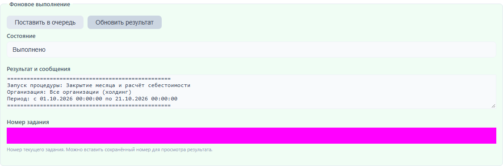

# Длительные операции

Закрытие месяца, импорт номенклатуры и выгрузку БП3 можно поставить в очередь. Укажите параметры и нажмите «Поставить в очередь». После запуска нажмите «Обновить результат»: состояние и сообщения появятся в форме. Дождитесь состояния «Выполнено» и проверьте итоговые сообщения. Если планируете закрыть вкладку раньше, сохраните номер задания: операция продолжит выполняться на сервере.

Проверьте итоговые сообщения, включая количество ошибок. Сохраните номер задания, если понадобится вернуться к результату: откройте обработку, вставьте номер и нажмите «Обновить результат». На иллюстрации номер скрыт.

Задания выполняются последовательно. Повторное нажатие, пока операция ожидает или выполняется, возвращает ту же задачу. Изменённые параметры в этом случае не заменяют параметры уже поставленной задачи. После завершения можно запустить новую операцию. Автоматических повторов после ошибки нет; проверьте сообщения и результаты перед повторным запуском.

При импорте JSON товар сопоставляется по артикулу, а при его отсутствии — по точному наименованию. Повторный импорт обновляет найденный товар. Используйте уникальные артикулы. Для выгрузки укажите путь на машине сервера. Закрытие месяца перепроводит документы в хронологическом порядке; при ошибках дата запрета не устанавливается.
