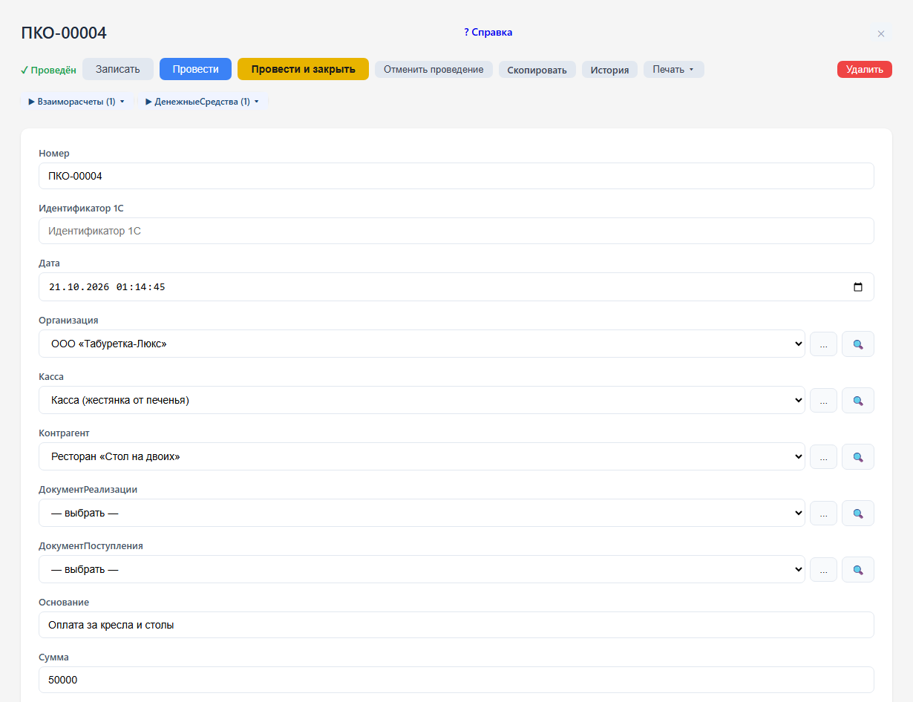

# Касса, банк и расчёты

## Приходный кассовый ордер

В разделе «Касса и банк» откройте «Приходный кассовый ордер» и создайте документ.

1. Проверьте дату и организацию. Номер присваивается при записи.
2. Выберите наличную кассу и контрагента, от которого поступили деньги.
3. Укажите сумму больше нуля и текстовое основание платежа.
4. Если это оплата конкретной продажи, заполните «Документ реализации». Для расчётов по закупке используется «Документ поступления». Укажите только одно из этих оснований.
5. Запишите документ и проведите его. Запись сохраняет документ; проведение отражает поступление денег и изменяет взаиморасчёты.

При указанном документе-основании система контролирует переплату. Платёж без документа-основания учитывается в общем сальдо контрагента, но не распределяется по реализациям автоматически. Проверить это можно в [карточке клиента](cards.md).

## Расходный ордер и банковские документы

«Расходный кассовый ордер» оформляет выдачу наличных. Заполните организацию, кассу, контрагента, сумму и при необходимости документ расчётов. При проведении проверяется достаточность денег в выбранной кассе организации на момент документа.

Для безналичных операций используйте «Поступление на расчётный счёт» и «Списание с расчётного счёта». В них выбирается банковский счёт, а в кассовых ордерах — наличная касса. Вид задаётся в справочнике «Касса»; кассу и банковский счёт нельзя взаимозаменять. Банковское списание также проверяет остаток денег.

В АРМ кассира выбирайте нужную операцию и проверяйте реквизиты созданного документа. Для импорта выписки откройте «Загрузка банковской выписки», укажите файл и параметры загрузки, изучите сообщения обработки и проверьте созданные банковские документы.

## Корректировка долга

Документ изменяет взаиморасчёты. Выберите организацию, вид операции, контрагента и сумму; при переносе долга укажите контрагента-получателя. В комментарии запишите причину корректировки. После проведения сверьте результат актом сверки. Движение наличных или денег на банковском счёте оформляется денежным документом.

## Как проверить результат

- «Остатки денежных средств» показывает остаток на выбранную дату; «Движение денежных средств» и «Выписка банка» — операции за период.
- В «Акте сверки» выберите контрагента и период, затем сформируйте отчёт.
- «Оплаты реализаций» и «Оплаты поступлений» помогают проверить погашение конкретных документов и просрочку. Платёж без основания проверьте отдельно в карточке контрагента.
- «Платежный календарь» используйте для просмотра предстоящих расчётов с учётом отборов отчёта.

Если проведение отклонено, прочитайте сообщение: возможны неверный вид кассы, незаполненный контрагент, неположительная сумма, переплата по основанию, недостаток денег или закрытый период. Исправьте причину и повторите проведение. В закрытом периоде нельзя также отменять проведение и удалять документы.
