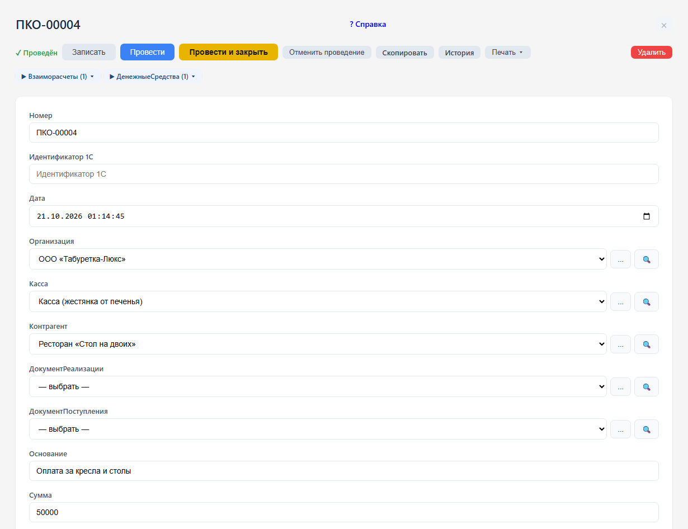

# Касса, банк и расчёты

## Приходный кассовый ордер

В разделе «Касса и банк» откройте «Приходный кассовый ордер» и создайте документ.

1. Проверьте дату и организацию. Номер присваивается при записи.
2. Выберите наличную кассу и контрагента, от которого поступили деньги.
3. Укажите сумму больше нуля и текстовое основание платежа.
4. Если это оплата конкретной продажи, заполните «Документ реализации». Для расчётов по закупке используется «Документ поступления». Укажите только одно из этих оснований.
5. Запишите документ и проведите его. Запись сохраняет документ; проведение отражает поступление денег и изменяет взаиморасчёты.

## Один платёж по нескольким документам

В кассовом или банковском документе укажите полную сумму и оставьте поля оснований в шапке пустыми. В таблице **«Распределение платежа»** добавьте по строке для каждого документа того же контрагента и организации. Для входящего платежа выбирайте реализации, для исходящего — поступления. Укажите положительную сумму с точностью до копеек по каждой строке и проведите документ.

Например, покупатель перечислил 10 000 ₽ за две продажи. Укажите 6 000 ₽ по первой реализации и 4 000 ₽ по второй. На счёте отразится одно поступление 10 000 ₽. В отчёте «Оплаты по реализациям» будут погашены обе продажи. При распределении 5 500 и 4 000 ₽ оставшиеся 500 ₽ учитываются как аванс. Его можно позднее распределить, дополнив строки этого платежа и перепроведя его в открытом периоде.

При единственном основании можно указать его в шапке и оставить таблицу пустой. Платёж с пустыми основаниями и пустой таблицей целиком отражается в общем сальдо контрагента. При проведении проверяются долг по каждому основанию и общая сумма распределения.

## Расходный ордер и банковские документы

«Расходный кассовый ордер» оформляет выдачу наличных. Заполните организацию, кассу, контрагента, сумму и при необходимости документ расчётов. При проведении проверяется достаточность денег в выбранной кассе организации на момент документа.

Для безналичных операций используйте «Поступление на расчётный счёт» и «Списание с расчётного счёта». В них выбирается банковский счёт, а в кассовых ордерах — наличная касса. Вид задаётся в справочнике «Касса»; кассу и банковский счёт нельзя взаимозаменять. Банковское списание также проверяет остаток денег.

В АРМ кассира выбирайте нужную операцию и проверяйте реквизиты созданного документа. Для импорта выписки откройте «Загрузка банковской выписки», укажите файл и параметры загрузки, изучите сообщения обработки и проверьте созданные банковские документы.

## Корректировка долга

Документ изменяет взаиморасчёты. Выберите организацию, вид операции, контрагента и сумму; при переносе долга укажите контрагента-получателя. В комментарии запишите причину корректировки. После проведения сверьте результат актом сверки. Движение наличных или денег на банковском счёте оформляется денежным документом.

## Как проверить результат

- «Остатки денежных средств» показывает остаток на выбранную дату; «Движение денежных средств» и «Выписка банка» — операции за период.
- В «Акте сверки» выберите контрагента и период, затем сформируйте отчёт.
- «Оплаты реализаций» и «Оплаты поступлений» помогают проверить погашение конкретных документов и просрочку. Платёж без основания проверьте отдельно в карточке контрагента.
- «Платежный календарь» используйте для просмотра предстоящих расчётов с учётом отборов отчёта.

Если проведение отклонено, прочитайте сообщение: возможны неверный вид кассы, незаполненный контрагент, неположительная сумма, переплата по основанию, недостаток денег или закрытый период. Исправьте причину и повторите проведение. В закрытом периоде нельзя также отменять проведение и удалять документы.

### Сверка банковской выписки

Предпросмотр показывает платежи и новых контрагентов. Сохранение записывает по одному платежу за транзакцию. Повторная загрузка пропускает совпавшие платежи и может провести ранее записанный черновик. Если реквизиты совпали с несколькими старыми документами или изменилась сумма, строка попадёт в ошибки.

Администратор может открыть «Настройки» → «Обмен данными» → «Сверка обменов». Без отбора по загрузке видны последние 100 строк банка, ЭДО и миграции из 1С. Выберите нужную загрузку, чтобы увидеть все её строки, и при необходимости укажите статус «Ошибка». Для удобства поиска при импорте можно указать название файла или источника. После исправления причины выберите ошибочную строку банка и нажмите «Повторить ошибочную строку банка». Для ЭДО и миграции повторно загрузите исправленный исходный файл. Ранее загруженный документ 1С с расхождением останется в базе для ручной сверки.

Если в базе несколько организаций, укажите организацию выписки или заполните расчётный счёт в карточке его владельца.

Для выгрузки из УТ 10 откройте «ВыгрузкаВOneBase_УТ10.epf». Сценарии COM export_ut10.os и export_ut11.os и обработка УТ 10 сохраняют исходное представление ставки. При загрузке дампа PuT распознаёт «Без НДС», процентные и расчётные ставки (например, «НДС 20%» и «7/107»). При неизвестной ставке строка ошибки содержит исходное значение. Для повторения исправьте исходный документ и заново выгрузите файл.
