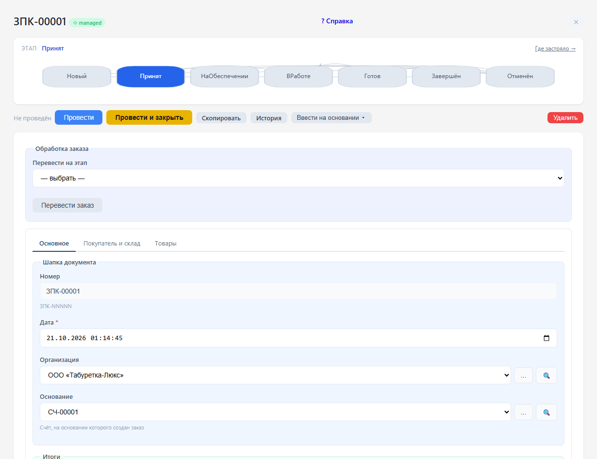

# Заказы и обеспечение

Этапы: Новый → Принят → На обеспечении / В работе → Готов → Завершён. Отмена доступна из незавершённых этапов. Для возврата готового заказа в работу используйте этап «В работе». Изменения сохраняются в истории документа.

Откройте заказ, выберите значение в поле «Перевести на этап» и нажмите «Перевести заказ». Текущий этап виден в верхней части формы. При недопустимом переходе программа объяснит причину.

Этап описывает работу с заказом. Фактическое исполнение определяется регистрами резервов и товаров в пути. Завершить или отменить заказ с незакрытым обеспечением нельзя: сначала оформите отгрузку, приёмку или документ закрытия. Завершённый/отменённый заказ нельзя проводить повторно.

## Закрытие заказов

Документы «Закрытие заказов покупателей» и «Закрытие заказов поставщикам» снимают оставшееся обеспечение по выбранным заказам. Проверьте организацию, заказы и закрываемые количества, затем проведите документ. После этого сверьте резервы или товары в пути и только затем завершайте либо отменяйте заказ. Закрытие заказа не заменяет фактическую отгрузку, приёмку или оплату.
