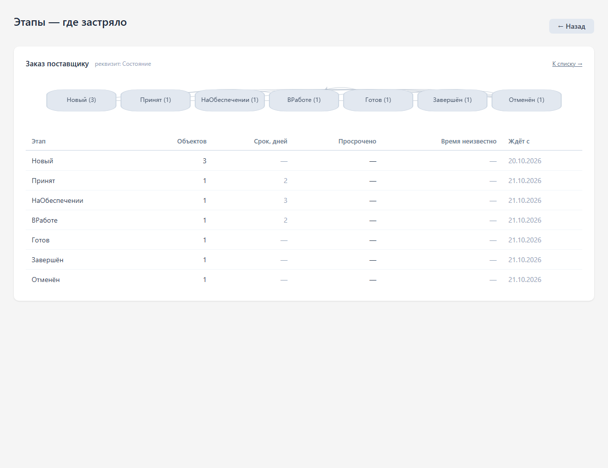

# Заказы и обеспечение

Этапы: Новый → Принят → На обеспечении / В работе → Готов → Завершён. Отмена доступна из незавершённых этапов. Для возврата готового заказа в работу используйте этап «В работе». Изменения сохраняются в истории документа.

Откройте заказ, выберите значение в поле «Перевести на этап» и нажмите «Перевести заказ». Текущий этап виден в верхней части формы. При недопустимом переходе программа объяснит причину.

Этап описывает работу с заказом. Фактическое исполнение определяется регистрами резервов и товаров в пути. Завершить или отменить заказ с незакрытым обеспечением нельзя: сначала оформите отгрузку, приёмку или документ закрытия. Завершённый/отменённый заказ нельзя проводить повторно.

## Где застряло

Нажмите «Где застряло» в сохранённом заказе. Откроется сводка по этапам этого вида заказов: количество, нормативный срок, просрочка и время ожидания. «Назад» вверху возвращает именно в исходный заказ; «К списку» открывает общий список документов.

## Примеры в демобазе

Найдите заказы по комментарию «Демо этапов». Для покупателей и поставщиков есть по одному примеру каждого этапа. «Новый» — непроведённый черновик; «Принят», «На обеспечении», «В работе» и «Готов» имеют реальное обеспечение. Завершённый заказ связан с проведённой приёмкой или реализацией; отменённый имеет документ снятия обеспечения. Историю переходов можно посмотреть в заказе. Время ожидания отсчитывается от настоящего перехода; сразу после ночного заполнения примеры ещё не просрочены.

Администратор может добавить отсутствующие примеры обработкой «Демо — добавить примеры этапов заказов», отметив «Это демонстрационная база». Обработка использует существующие демо-справочники и сохраняет прежние документы; повторный запуск не создаёт дубликаты. В обычной рабочей базе её не запускают.

## Закрытие заказов

Документы «Закрытие заказов покупателей» и «Закрытие заказов поставщикам» снимают оставшееся обеспечение по выбранным заказам. Проверьте организацию, заказы и закрываемые количества, затем проведите документ. После этого сверьте резервы или товары в пути и только затем завершайте либо отменяйте заказ. Закрытие заказа не заменяет фактическую отгрузку, приёмку или оплату.
